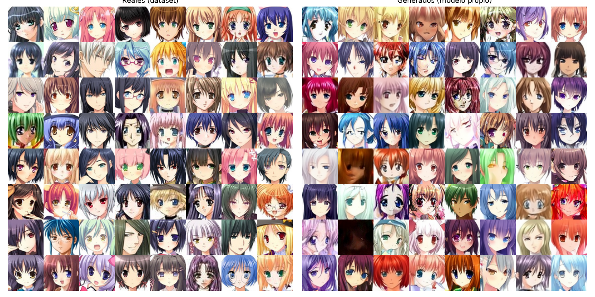
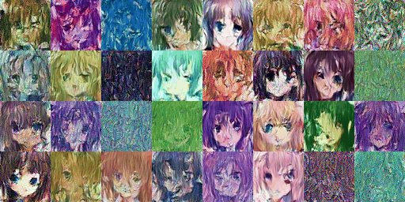
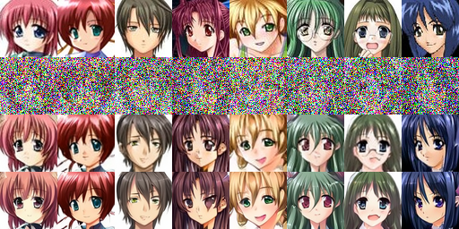

# Difusión de rostros de anime condicionada por época

Modelo de difusión (DDPM) entrenado desde cero que genera rostros de anime de 64×64. Además del ruido recibe una **época** (2000-2004, 2005-2009, 2010-2014 o 2015-2019), tomada del año que cada archivo del dataset trae en su nombre, y dibuja el rostro con el estilo de esa época.

Práctica Calificada 3 de Computación Gráfica (opción 3: modelo de difusión).

**Autores:** Isaac Antonio Martel Balvin · Sebastian Enrique Huaypar Acurio

Parte del Colab de clase *Diffusion Models* (CelebA, TensorFlow) y del paper de DDPM (Ho et al., 2020).

| Rostros reales y generados | Evolución durante el entrenamiento |
|---|---|
|  |  |

## Contenido

| Archivo | Qué es |
|---|---|
| `01_entrenamiento.ipynb` | Script de entrenamiento, ejecutado: hiperparámetros, datos, modelo, log de las 50 épocas y evidencias |
| `02_resultados.ipynb` | Script de obtención de resultados, ejecutado: carga los pesos y genera rostros |
| `modelo.py` | U-Net, proceso de difusión (DDPM y DDIM) y EMA |
| `preparar_datos.py` | Convierte el zip del dataset en `datos/anime64.npz` |
| `pesos/pesos_ema.pt` | Pesos obtenidos (EMA, 72,9 MB) |
| `pesos/log_entrenamiento.json` | Pérdida y tiempo de cada época de entrenamiento |
| `muestras/` | Una grilla de muestras por época de entrenamiento, curva de pérdida y GIF de evolución |
| `resultados/` | Figuras que genera `02_resultados.ipynb` |
| `PC3_Presentacion.mp4` | Video de la presentación |

## Entrenamiento

| | |
|---|---|
| Datos | Anime Face Dataset, 63 565 rostros |
| Modelo | U-Net de 18,2 M de parámetros, condicionada por tiempo y época |
| Difusión | T = 1000, β lineal de 1e-4 a 0,02, pérdida MSE sobre el ruido |
| Entrenamiento | 50 épocas, 49 650 pasos, lote 64, AdamW 2e-4 |
| Equipo y tiempo | NVIDIA RTX 4060 de 8 GB, 4,71 horas |
| Pérdida | 0,1717 en la época 1 → 0,0269 en la época 50 |

El log completo, la curva de pérdida y las muestras de cada época están en las secciones 5 y 6 de `01_entrenamiento.ipynb`.

## Cambios respecto al Colab de clase

| | Colab de clase | Este trabajo |
|---|---|---|
| Datos | CelebA (rostros reales) | Anime Face Dataset |
| Condición | ninguna | época, con guía sin clasificador |
| Data augmentation | función vacía | volteo horizontal aleatorio |
| Pérdida | Huber | MSE |
| Estabilidad | — | EMA de pesos, warmup y recorte de gradiente |
| Muestreo | DDPM, 1000 pasos | DDPM y DDIM de 50 pasos |
| Framework | TensorFlow / Keras | PyTorch con precisión mixta |

Se mantiene la base del Colab: mismo esquema de ruido, imágenes de 64×64 en [-1, 1] y una U-Net de tamaño similar.

## Resultados

Todos están en `02_resultados.ipynb`.

1. **Reales frente a generados.** 64 rostros sin filtrar; algunos fallan.
2. **DDPM frente a DDIM.** 3,46 s por imagen con 1000 pasos y 0,18 s con DDIM de 50 pasos.
3. **Misma semilla, distinta época.** El mismo ruido da el mismo personaje con el estilo de cada época.
4. **Medición por época.** Brillo y saturación de 512 rostros reales y 512 generados por época: los generados siguen la tendencia de los reales.
5. **Guía sin clasificador.** Efecto del peso de la guía.
6. **Proceso inverso.** De ruido a rostro, paso a paso.
7. **Interpolación** entre dos ruidos iniciales.
8. **¿Memoriza?** Vecino más cercano en el dataset para cada rostro generado.
9. **Extra: rostro real a otra época.** Se añade ruido a un rostro real hasta t = 450 y se quita pidiendo otra época.
10. **Ajuste de DDIM.** Recalcular el ruido después de recortar la imagen estimada.

Rostros reales de 2000-2004 (fila 1), con ruido en t = 450 (fila 2), redibujados sin cambiar la época (fila 3) y redibujados como 2015-2019 (fila 4):



## Cómo reproducirlo

Los notebooks ya están ejecutados y los pesos están en el repositorio, así que para revisar los resultados no hace falta ejecutar nada.

Para volver a ejecutarlos (Python 3.12 y una GPU NVIDIA):

```
pip install -r requirements.txt
```

1. Descargar el [Anime Face Dataset](https://www.kaggle.com/datasets/splcher/animefacedataset) de Kaggle y guardar el zip como `datos/anime_faces.zip`.
2. Ejecutar `python preparar_datos.py`. Lleva las imágenes a 64×64, toma el año del nombre de cada archivo y guarda todo en `datos/anime64.npz`.
3. Ejecutar `02_resultados.ipynb` para generar rostros con los pesos incluidos, o `01_entrenamiento.ipynb` para entrenar desde cero.

El dataset no se incluye en el repositorio por su tamaño.
